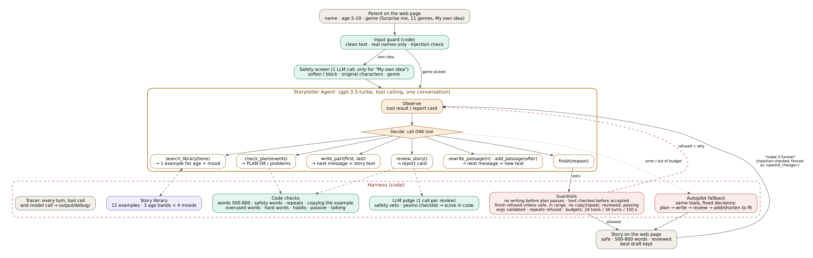

# 🌙 Bedtime Story Maker

A bedtime story for children aged 5 to 10, written by an **AI agent**. A parent picks a **name**, an **age** and a **kind of story** on a simple web page. A gpt-3.5-turbo **Storyteller Agent** then reads an example story for that age and mood, plans its own story, writes it, reviews it with code checks and an LLM judge, fixes what's wrong, and hands it over: always safe for the age, and always **500–800 words**. Parents can ask for changes ("make it funnier"), and the same agent makes them.



---

## Quick start

```bash
python3 -m venv .venv && source .venv/bin/activate
pip install -r requirements.txt
cp .env.example .env            # paste your OpenAI key into .env (never commit it)
python app.py                   # opens http://127.0.0.1:8000
```

The page is a storybook. A "This book belongs to" bookplate takes the child's name (optional; they become the hero). Round buttons set the age (5–10: safety rules, tone, words and length). The kinds of story are cloth-bound books on a **bookshelf**: Surprise me, 11 genres, or *My own idea*, the only one that asks for text. The finished story arrives as a **cover** stamped with its title and "a story for Maya", then opens into pages you turn (buttons, arrow keys or swipe). **Read to me** reads it aloud with the computer's own voices - softest first (on a Mac, the downloadable *Premium* voices such as Ava or Zoe), slowly, with a short pause between sentences - highlighting each sentence and turning the pages. The chosen voice is remembered, and nothing leaves the computer. It works on any computer: Windows in Microsoft Edge gets natural voices (Aria, Jenny), Chrome gets Google voices, and the page shows a tip for getting a softer voice on that kind of computer. Terminal version: `python main.py`.

---

## Models used

**Only `gpt-3.5-turbo`, as the assignment requires - for every model call in the app.** The safety screen, the Storyteller Agent (planning, writing, fixing) and the judge all run on it (`bedtime/config.py: CORE_MODEL`). There are exactly two places that call the OpenAI API, both in `bedtime/llm.py`, and both use `CORE_MODEL`. No image, voice or other model is used anywhere. The page's design and the read-aloud are plain browser features: read-aloud uses the computer's own voices.

## The Storyteller Agent

One gpt-3.5 **author** plans, writes and fixes the whole story in **one conversation**, so it never loses track of what the story is about. Code around it **measures, guards and records**. (`bedtime/agent.py`)

```
observe (tool result / report card) → decide → call ONE tool → observe → …
```

### Tools

| Tool | What it does | What the agent gets back |
|---|---|---|
| `search_library(tone)` | Picks **one** example story from a local library, matched to the child's age band and the mood | The example, fenced as `<example_story>`, plus the rule: copy *how* it is told, never *what* |
| `check_plan(title, characters, events)` | Code checks the agent's own plan: enough events for 500–800 words, no near-duplicate events, nobody asleep before the end, ends in bed, safe for the age, includes the listener and the parent's characters, **doesn't copy the example** | `PLAN OK`, or a numbered list of problems to fix |
| `write_part(first, last)` | Opens a writing slot for up to 4 events. The agent's **next message** is the story text. | Word count so far against the range, and what to write next |
| `review_story()` | Code checks plus one LLM judge call | A report card: words, safety, repeats, copying, overused words, hard words, the score and the editor's fixes, plus the story in numbered passages |
| `rewrite_passage(n, what_to_change)` | Opens a slot to rewrite one passage | The new word count |
| `add_passage(after, new_event)` | Opens a slot for a passage with a **new event**. This is how a short story grows; it never pads. | The new word count |
| `finish(reason)` | Asks to hand the story to the parent | `FINISHED`, or **refused** with the reasons |

### How it's designed

- **The agent decides, code guarantees.** gpt-3.5 handles the judgement calls: what to write, which problem to fix, how. Code holds everything that must be true: safety, the word range, no copying, no repeats.
- **Order comes from refusals, not a script.** The agent is free to choose its next step, but code refuses unsafe moves and says why. There's no writing before the plan passes, and no `finish` while the story is unsafe, outside 500–800 words, copies the example, repeats itself, has unwritten events, has changed since the last review, or fails the score while steps remain.
- **Story text goes in plain messages, never inside tool arguments.** Long text with quotation marks breaks gpt-3.5's tool-call format. Tool calls only carry short things like numbers and notes.
- **Everything the agent writes is checked before it's accepted.** That covers refusals and chatter ("I'm ready for the task!"), retelling what already happened, falling asleep early, and words that aren't suitable for the age. A rejected text keeps the slot open so the agent can try again.
- **Memory:** the conversation holds the brief, the example, the plan, every word written and every review. Passage numbers stay the same between edits, so "passage 4" always means the same passage.
- **Budgets:** 24 tool calls, 34 turns and 150 seconds. Identical repeated actions are refused. A turn without a tool call gets a nudge.
- **Fallback (autopilot):** if the agent breaks or runs out of budget, the same tools run with fixed decisions: plan → write the remaining events → review → add or shorten passages until the length fits. The parent always gets a reviewed story.
- **Best draft kept:** every review is a scored draft, and a worse one never replaces a better one. Safety always outranks quality. For a parent's change, the best *changed* draft is returned, so the change is never silently dropped.
- **Untrusted text stays fenced:** `<story_brief>`, `<parent_change>`, `<editor_note>`, `<example_story>` and `<story>` are data, never instructions (see *Prompt-injection defence*).
- **Long-term memory** (`bedtime/memory.py`): the names, ideas and titles of recent stories are remembered between runs. The agent is told not to reuse them, and `check_plan` refuses recently used names.
- **Variety from code, not from gpt-3.5's favourites:** each genre has 12 story sparks and code picks one at random. If the parent gave no name, code picks a hero name from 30. The plan check refuses tired bedtime ideas (fireflies, glowing lights or stars in the sky, a noise at the window). Real runs had twinkling in 15 of 21 stories and heroes called Luna, Lily or Lila.
- **The parent's idea is the heart:** for "My own idea", the plan must state its heart in one sentence, and it has to be about what the parent asked for.
- **Observable:** every agent turn, tool call and model call is saved to `output/debug/*.json`, with an `agent_log` of its decisions. See [`docs/sample_agent_run.md`](docs/sample_agent_run.md).

### What happens before the agent (always, in code)

| Step | What it does |
|---|---|
| **Input guard** | Cleans the text, accepts only real-looking names, and detects prompt-injection phrases. |
| **Safety screen** (1 LLM call, *only for "My own idea"*) | Softens unsuitable ideas instead of refusing ("a dragon that burns a village" becomes a dragon learning gentle sparks), swaps trademarked characters for original ones, and picks the genre. Screening is never left to the agent. |

---

## The story library: tone without copying

gpt-3.5 copies the voice of an example far more faithfully than it follows a description of a style. So tone comes from **one example story matched to the child**, from a local library of 12 (`bedtime/library.py`):

| | funny | cozy | mystery | adventure |
|---|---|---|---|---|
| **5–6** | Bobo and the Round Green Door *(after Winnie-the-Pooh)* | Little Hen's Warm Bread *(The Little Red Hen)* | Who Took a Bite of the Moon? *(original)* | The Little Mouse and the Big Lion *(Aesop)* |
| **7–8** | Town Mouse and Country Mouse *(Aesop)* | The Shoemaker's Little Helpers *(Grimm)* | The Mystery of the Missing Socks *(original)* | The Tortoise and the Hare *(Aesop)* |
| **9–10** | The Princess and the Pea *(Andersen)* | Heidi's Bed in the Hay *(Spyri)* | The Secret Garden *(Burnett)* | Mole's First Day on the River *(Grahame)* |

All of them are originals or simple retellings of out-of-copyright classics. **Every example passes the same checks as the stories the app makes:** the age's sentence length, hard words, amount of talking, no repeats, no overused words. An example that broke the rules would teach the wrong voice.

**Not copying is enforced in code.** Each example has a list of its own names and ideas. A plan or story that uses two or more of them, or shares more than 5% of its phrases with the example, fails `check_plan` and `finish`.

---

## What went wrong on the way, and how the design changed

The app was built by testing against real gpt-3.5 output and reading the step-by-step records of every run. The key findings:

| Seen in real runs | Cause | What changed |
|---|---|---|
| 12 of 12 stories were "a sound in the bedroom turns out to be X" | The planner form only had slots for that one plot ("one place, one small thing, at most three things happen") | The agent plans 8–11 different events. `check_plan` rejects thin plans and duplicate events. Small gentle adventures are allowed, always ending in bed. |
| "whisper" 506 times, "peek" 178, "yawn" 148 in 12 stories; "They talked back and forth" pasted in | gpt-3.5 copies the words in its instructions into the story | Instructions contain **no sample phrases**; the voice comes from the example only. An overused-words check caps them per story. |
| Asked for 740 words, it wrote parts of 15–40 words (~150 in total) | gpt-3.5 writes about a third of what it's asked for in one long reply | It writes up to 4 events per turn, with about 70 words each of real content. Length comes from **events**. |
| The same moment told four times; Sophie falls asleep four times | Separate "make this longer" calls with no memory padded tiny pieces with lines from the plan | **One author** with full memory. No stretching anywhere. A repeat check, and nobody asleep before the end. |
| A narration line turned into speech ("Suddenly, a humming sound…," Sophie said) | "Add more talking" applied to a piece with nothing new to say | No padding rewrites. A rewrite must have a reason from the review. |
| Replies like "I'm sorry, but I can't continue…" and "I'm ready for the task! Please provide the plan." became stories | An 1,800-word prompt with the example pasted in the middle confused gpt-3.5, and the code accepted any reply | The example comes back as a tool result in a short conversation. Refusals and chatter are never accepted as story text. |
| "I couldn't make that story gentle enough" for a safe age-10 space story | The judge filed "simplify the language", "remove the mouse, it isn't connected to the plot" and "change 'hesitantly' to 'curiously'" under *safety*; the writer wrote 88 of 288 words in fancy words; the children went into dark woods alone | Code decides what counts as safety: checklist notes, wording, style and plot notes go to the editor's fixes, and a note quoting text that isn't in the story is dropped. Writing is sent back once at once if it's under 60% of the ask or too fancy. The plan check and instructions say children never go out at night without a grown-up. The review card says how many events to add. |
| An agent fixed one thing, saw 2.6/10, and finished | `finish` only checked safety and length | `finish` is refused while the story fails and steps remain. |
| A 197-word story scored 10/10 | The gpt-3.5 judge says "yes" to almost everything | The score shown subtracts 2 per failed code check and is capped at 5 when the length is wrong. |

Real gpt-3.5 failure stories are kept in `tests/samples/`, and each failure above has a test.

---

## Checks and judging

- **Code checks** (`bedtime/checks.py`):
  - **Length:** 500–800 words, and within 20% of the age's target.
  - **Safety:** banned words for the age.
  - **Readability:** hard words (3+ syllables, or flowery words like "tranquil") at most 3% / 5% / 8% by age; average sentence length; how much talking.
  - **Artificial writing:** gpt-3.5 habits (", her eyes shining with curiosity", named feelings, "exclaimed"), passive voice, and overused words.
  - **Story shape:** repeated sentences, falling asleep too early, and copying the example.
  - **Request:** the listener's name and anything the parent asked for.
  - **Tone:** stated morals and machine-sounding clichés.
- **The LLM judge** (one call per review) returns safety issues and a yes/no checklist: hook, fits the request, clear story, the hero acts, one connected story, shown not told, small real details, fun to read aloud, real talking, a picture-book voice, a calm ending, a slow breath together, every word understandable, and (if a name was given) the child as hero. Code turns the answers into a score.
- **A story passes** only with no safety issues, no failed code checks, and a score of 8/10 or more. A story that is never judged safe is never shown.

### Age tiers
| Ages | Words | Rules |
|---|---|---|
| 5–6 | 500–600 (age 5), 500–672 (age 6) | Very simple words, sentences under 9 words on average, at least 25% talking. No villains, danger, getting lost, death, scary monsters or unkindness. Nothing a child might copy. |
| 7–8 | 500–744 (age 7), 544–800 (age 8) | At least 20% talking. Mild problems are fine. "Scary" things turn out friendly. Villains are only silly. No death. |
| 9–10 | 592–800 (age 9), 640–800 (age 10) | Light suspense and mysteries, resolved warmly. No violence. No fear left at the end. |

### Prompt-injection defence
- **Sandwich prompts:** every system prompt carries the same security rules, untrusted text sits inside tags, and every prompt that contains untrusted text ends with a reminder of the model's one job.
- **Code guards:** `<` and `>` are stripped so tags can't be closed early, inputs are length-capped, only real names are accepted, injection phrases are detected, a parent change that is only an injection is ignored, and the screen's own output is re-checked.
- **Defence in depth:** whatever happened earlier, the final story must still pass the code checks and the judge's safety veto before `finish` is accepted.

---

## Tests and evaluation

```bash
pytest -q                     # 124 offline tests; scripted fakes stand in for gpt-3.5
python -m evals.run_evals     # baseline (the skeleton's raw prompt) vs the agent, same checks and judge
```

- `tests/test_agent.py` covers the agent loop, every tool, every refusal and guardrail, budgets, the autopilot fallback, parent changes, tracing, and the real failures listed above. The agent is played by a scripted author that reacts to what the harness says, and bad behaviour is scripted on purpose.
- `tests/test_library.py` checks that every example follows the rules it teaches, every age and mood is covered, and copying is caught.
- `evals/run_evals.py` runs 12 cases (all ages, unsafe requests, prompt injection, a trademarked hero, a sensitive day). It reports score, safety, words in range, agent steps, who finished (the agent or the autopilot), and time.

## Project layout

```
app.py                  web server (standard library only; listens on 127.0.0.1)
web/index.html          the page: name, age, genre, story, changes
main.py                 terminal version of the same flow
bedtime/agent.py        the Storyteller Agent: tools, harness, guardrails, autopilot fallback
bedtime/library.py      12 example stories by age band and mood (tone source)
bedtime/memory.py       the agent's memory of recent stories (names, sparks, titles)
bedtime/pipeline.py     input screening, text helpers (layout, pages), create_story / apply_feedback
bedtime/prompts.py      every prompt, in one place
bedtime/checks.py       deterministic checks
bedtime/judge.py        code checks + the single LLM judge, score in code
bedtime/guard.py        prompt-injection defences
bedtime/llm.py          call_model + call_chat with tools (gpt-3.5-turbo) + validated JSON
bedtime/trace.py        saves every model call and agent turn to output/debug/
evals/, tests/, docs/
```

## Limitations and what I'd do next
- **gpt-3.5 is a weak author and a weak planner.** The design makes its stories coherent, varied and in range, but the writing stays plain. With a free choice of model, the agent's brain would be the first thing to upgrade.
- **The judge is the same model as the writer**, so its scores are optimistic. The code checks and the baseline comparison are the more reliable signals. Pairwise "A vs B" judging would help.
- **A 12-story library is small.** More examples per age and mood (for example openly licensed StoryWeaver stories, with credit) would add variety.
- **Keyword lists are blunt.** The LLM safety review exists to catch what they miss.
- **Model note:** everything uses `gpt-3.5-turbo` (`bedtime/config.py: CORE_MODEL`); no other model is used. The OpenAI SDK was upgraded from the legacy `openai.ChatCompletion` interface to the current client, which is needed for tool calling.
